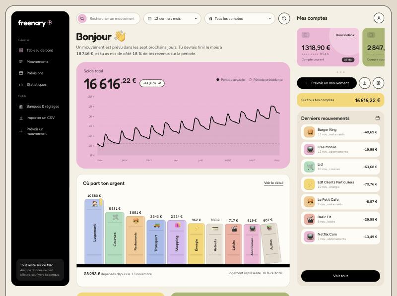
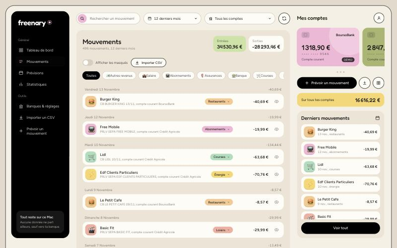
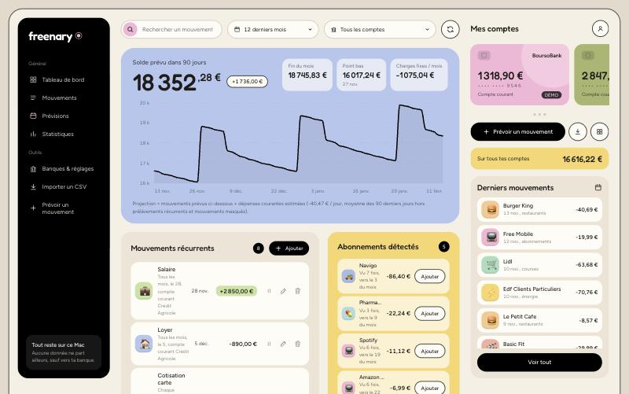
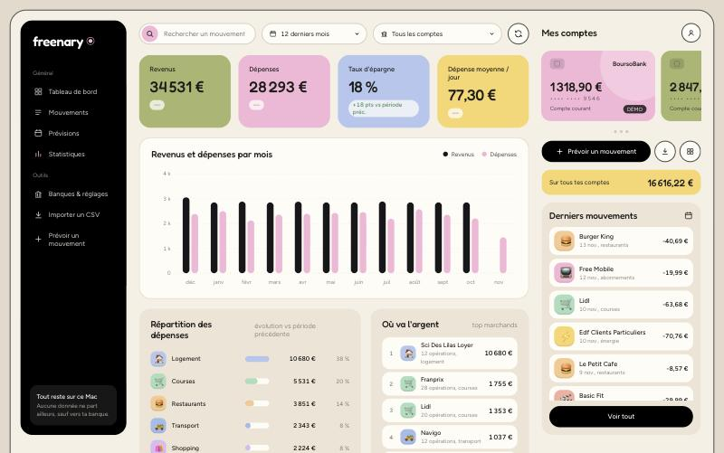
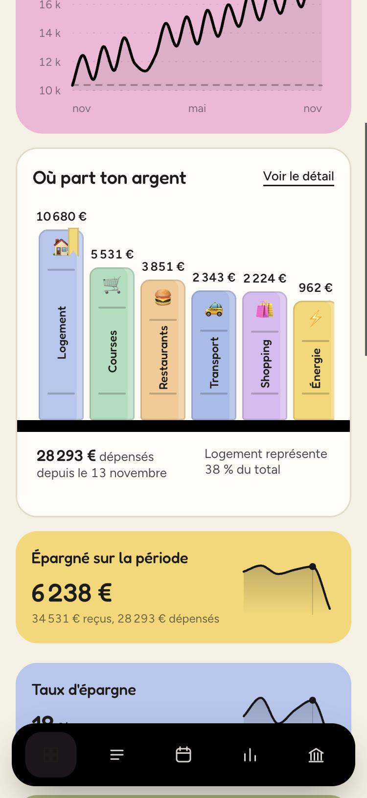
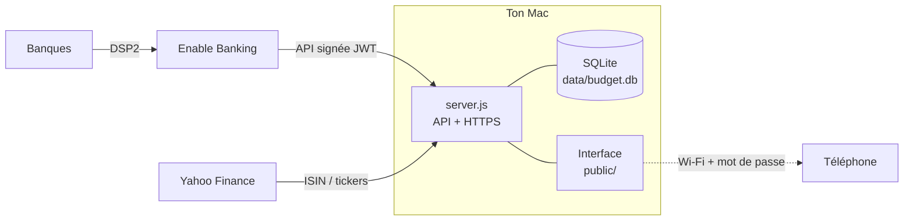

<div align="center">


# freenary

**Tes comptes bancaires, chez toi, sur ton Mac.**
Soldes, mouvements triés par catégorie, prévisions et statistiques, sans cloud ni abonnement.

[](LICENSE)
[](https://nodejs.org)
[](package.json)
[](https://www.conventionalcommits.org/fr/v1.0.0/)



<sub>Captures réalisées avec les données de démonstration fournies, jamais avec de vrais comptes.</sub>

</div>

---

## Pourquoi Freenary

Les agrégateurs comme Finary sont pratiques, mais ils hébergent tes données bancaires. Freenary fait l'inverse : **une petite application qui tourne sur ton ordinateur**, se branche à tes banques par l'API officielle européenne (DSP2, via [Enable Banking](https://enablebanking.com)) et garde tout dans un fichier SQLite local.

- **Chez toi** : aucune donnée n'est envoyée à un serveur tiers autre que ta banque (voir [Confidentialité](#confidentialité-et-sécurité)).
- **Sans dépendance** : Node.js seul, pas de `npm install`, pas de build.
- **À ton image** : tu peux tout lire, tout modifier, tout archiver.

## Fonctionnalités

| | |
|---|---|
| **Soldes et mouvements en direct** | Connexion DSP2 aux banques françaises (plus de 100 sont proposées), synchronisation automatique toutes les 6 heures. |
| **Catégories automatiques** | Règles par mots entiers sur le libellé nettoyé. Un clic reclasse un marchand, y compris ses mouvements futurs. Les mouvements peuvent être masqués des statistiques. |
| **Où part ton argent** | Une étagère de livres : un livre par catégorie, sa hauteur suit le montant dépensé. |
| **Prévisions** | Mouvements récurrents, abonnements détectés automatiquement, solde estimé à 90 jours avec point bas et fin de mois. |
| **Statistiques** | Revenus et dépenses sur 12 mois, évolution par catégorie, top marchands. Les virements entre tes comptes ne comptent ni comme revenu ni comme dépense. |
| **Livrets et PEA** | Comptes suivis à la main (la DSP2 ne couvre pas l'épargne). Les virements depuis ton compte courant les mettent à jour tout seuls. Un PEA se valorise à partir de ses parts, avec la dernière valeur liquidative officielle ou une estimation en direct. |
| **Import CSV** | Pour les comptes suivis à la main. |
| **Sur ton téléphone** | Accès depuis ton Wi-Fi, protégé par mot de passe et HTTPS. Installable sur l'écran d'accueil. |

<table>
  <tr>
    <td></td>
    <td></td>
  </tr>
  <tr>
    <td></td>
    <td align="center"></td>
  </tr>
</table>

## Démarrage rapide

Prérequis : [Node.js](https://nodejs.org) **22.5 ou plus** (pour le module SQLite intégré) et `openssl` (déjà présent sur macOS et Linux).

```bash
git clone https://github.com/tmcrn/freenary.git
cd freenary
npm start
```

Ouvre ensuite <http://localhost:4848>. Au premier lancement, des **comptes fictifs** sont créés pour que tu voies l'application remplie ; tu pourras les supprimer depuis *Banques & réglages*.

```bash
NO_DEMO=1 npm start      # démarrer à vide, sans comptes fictifs
npm run reset-demo       # repartir de zéro avec les données de démo (efface data/budget.db)
```

## Connecter tes banques

Freenary utilise l'API d'agrégation d'[Enable Banking](https://enablebanking.com). Le mode gratuit pour usage personnel suffit : tu ne relies que tes propres comptes.

1. Crée un compte sur enablebanking.com, puis une application **Production** dans leur *Control Panel*. Génère la clé dans le navigateur et **garde le fichier `.pem`**.
2. Déclare l'adresse de redirection `https://localhost:4848/api/eb/callback`.
3. Clique sur **Link accounts** et relie tes comptes (mode restreint : seuls les comptes reliés sont accessibles).
4. Dans Freenary, ouvre *Banques & réglages*, saisis l'**Application ID**, charge le `.pem`, puis **Connecter une banque**. Après ton accord chez la banque, le navigateur t'avertit du certificat local (voir plus bas) : accepte, et les comptes s'importent.

À savoir : la DSP2 ne couvre que les **comptes de paiement** (compte courant, parfois carte). Livrets, PEA et assurance-vie se suivent à la main dans Freenary. Le consentement dure environ **180 jours** ; un bouton *Reconnecter* apparaît à l'expiration.

## Accéder à Freenary depuis ton téléphone

Désactivé par défaut. Pour l'activer, ouvre *Banques & réglages* **sur le Mac**, carte *Accès depuis le téléphone* :

1. Choisis un mot de passe (8 caractères minimum) et coche l'autorisation.
2. Sur ton téléphone, connecté au même Wi-Fi, ouvre l'adresse affichée (de la forme `https://nom-du-mac.local:4848`) dans Safari.
3. Safari signale que la connexion n'est pas privée : le certificat est celui de ton Mac. *Afficher les détails*, puis *Visiter ce site web*.
4. Facultatif : installe le certificat (`/cert`) pour supprimer l'avertissement et ajouter Freenary à l'écran d'accueil.

Le Mac doit être allumé, Freenary lancé, et les deux appareils sur le même réseau. Les actions sensibles (connexion bancaire, clé Enable Banking, gestion de l'accès) restent **réservées au Mac**.

## Confidentialité et sécurité

**Où sont tes données.** Dans le dossier `data/` (ignoré par Git) : la base SQLite, la clé Enable Banking (droits `600`), le certificat local et, si tu l'actives, le condensat de ton mot de passe d'accès téléphone.

**Ce qui sort de ton Mac.**

| Destination | Pourquoi | Ce qui est envoyé |
|---|---|---|
| API Enable Banking | Récupérer soldes et mouvements | Requêtes signées avec ta clé privée |
| Yahoo Finance | Cours et valeurs liquidatives d'un PEA | Uniquement des codes ISIN ou tickers |
| Google Fonts | Polices de l'interface | Ton adresse IP, comme pour tout site qui charge une police |

**Protections du serveur local.**

- Écoute sur `127.0.0.1` seulement, sauf si tu actives l'accès téléphone.
- Vérification de l'en-tête `Host` (contre le *DNS rebinding*) et de `Origin` / `Sec-Fetch-Site` (contre les requêtes venues d'un autre site), corps JSON obligatoire pour toute écriture.
- Politique de sécurité de contenu (CSP) stricte : aucun script externe ni en ligne.
- Accès réseau : mot de passe haché (scrypt), cookie signé `HttpOnly` / `SameSite=Strict` / `Secure`, blocage après 5 essais ratés, HTTPS imposé.
- Le jeton OAuth de la banque est vérifié (`state`) avant tout échange de code.

Voir aussi [SECURITY.md](SECURITY.md). **Ne publie jamais le contenu de `data/`**, et n'ouvre pas d'*issue* contenant de vraies données bancaires.

## Comment ça marche



```
server.js            serveur HTTP(S) local, garde de sécurité, routes de l'API
lib/db.js            schéma SQLite et migrations
lib/logic.js         mouvements, catégories, statistiques, prévisions, import CSV, virements liés
lib/enablebanking.js connecteur DSP2 (JWT, consentement, synchronisation)
lib/portfolio.js     valorisation des PEA (parts, versements, valeur officielle ou en direct)
lib/quotes.js        cours et valeurs liquidatives
lib/access.js        accès depuis un autre appareil (mot de passe, session, anti force brute)
lib/seed.js          catégories, règles et données de démonstration
public/              interface (HTML, CSS et JavaScript natifs, graphiques SVG faits main)
```

## Configuration

| Variable | Rôle | Défaut |
|---|---|---|
| `PORT` | Port d'écoute | `4848` |
| `NO_DEMO` | `1` pour ne pas créer les comptes fictifs | non défini |
| `FREENARY_DATA` | Dossier des données | `./data` |
| `EB_APPLICATION_ID`, `EB_PRIVATE_KEY_PATH`, `EB_REDIRECT_URL` | Alternative à la saisie dans les réglages | non définies |

## Limites connues

- La DSP2 ne donne accès qu'aux comptes de paiement : l'épargne et les placements se saisissent à la main.
- La valeur « en direct » d'un fonds est une **estimation** à partir de l'ETF qu'il réplique ; la valeur officielle arrive avec quelques jours de retard.
- Les cours viennent d'une source non officielle (Yahoo Finance), qui peut changer ou s'interrompre.
- Pas de suite de tests automatisée pour l'instant.
- Conçu pour un usage personnel, un seul utilisateur.

## Contribuer

Les contributions sont bienvenues. Les messages de commit suivent les [Conventional Commits](https://www.conventionalcommits.org/fr/v1.0.0/) (`feat:`, `fix:`, `docs:`, `refactor:`, `chore:`…) et les versions suivent le [versionnage sémantique](https://semver.org/lang/fr/). Les changements notables sont listés dans [CHANGELOG.md](CHANGELOG.md).

## Licence

[MIT](LICENSE)
